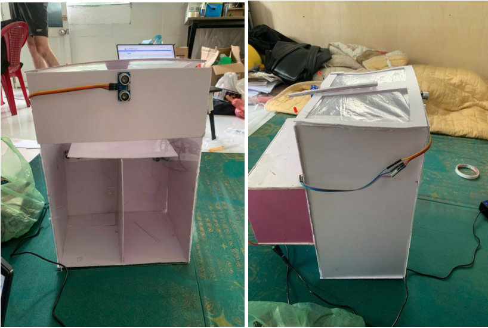
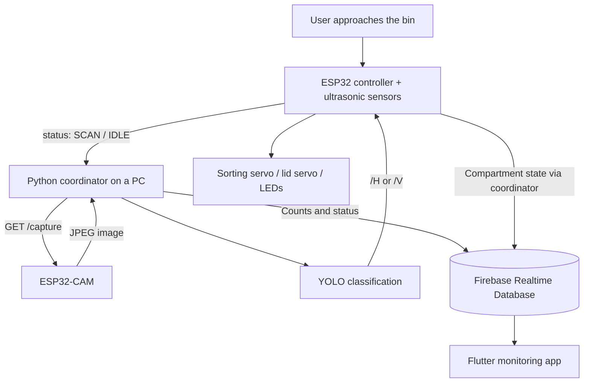
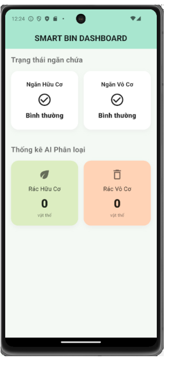

# Smart Trash — AI-Powered Waste Sorting System

> Academic **AI + IoT prototype** that detects waste, sorts it into organic/inorganic bins, and reports bin status through a companion mobile application.

**Stack:** ESP32 · ESP32-CAM · Arduino/C++ · Python · Ultralytics YOLO · OpenCV · Firebase Realtime Database · Flutter

## Overview

Smart Trash combines a touch-free lid, camera-based waste recognition, motorized sorting, ultrasonic fill-level monitoring, and remote status visualization. AI inference takes place on a **separate computer running Python**, not on the ESP32-CAM.

This is an academic prototype developed for a microcontroller course, **not a production waste-management product**.

## Features

- Touch-free lid operation using an ultrasonic sensor and a servo.
- Image capture over local Wi-Fi from an ESP32-CAM (`GET /capture`).
- Organic vs. inorganic waste classification with a locally loaded YOLO model (`trash.pt`).
- Servo-controlled sorting using the controller commands `/H` and `/V`.
- Independent fill-level sensing for two compartments with LED alerts.
- Waste statistics and compartment status stored in Firebase Realtime Database.
- Flutter dashboard showing bin status and sorting counts.

## System architecture

**Important:** The ESP32-CAM serves images; the Python process performs inference and issues control commands. The demo relies on the local network and a running PC.

## Repository map

| Path | Role |
| --- | --- |
| `app.py` | Polls controller state, captures images, runs YOLO, issues sorting commands, updates Firebase |
| `cam_trash_smart.ino` | ESP32-CAM firmware exposing the HTTP image capture endpoint |
| `vdk_trask_smart.ino` | ESP32 controller firmware for sensors, servos, LEDs, and HTTP commands |
| `trash.pt` | Model weights loaded by the Python coordinator |
| `smart_bin_app/` | Companion application directory; consult its source for exact setup |
| `test/` | Repository test/support directory; consult its contents for details |

## Demo

The team evaluated the prototype on a small set of **50 waste samples** (25 organic, 25 inorganic). The course report contains inconsistent aggregate accuracy figures, so this README intentionally avoids presenting a single accuracy percentage until the test records are reconciled. This is not a validated production benchmark.

## Local setup (prototype)

1. Prepare an ESP32 controller, ESP32-CAM, ultrasonic sensors, two servos, LEDs, appropriate power supplies, and a common local Wi-Fi network.
2. Open `vdk_trask_smart.ino` and `cam_trash_smart.ino` in Arduino IDE; choose the appropriate ESP32 board targets, configure Wi-Fi **locally**, and flash each device.
3. Set the controller and camera network addresses in `app.py` (`ESP_MAIN_IP`, `ESP_CAM_IP`) to match the devices on the LAN.
4. Prepare a Python environment. The coordinator imports `opencv-python`, `requests`, `numpy`, `ultralytics`, and `firebase-admin`.
5. Configure a Firebase Realtime Database and provide its service-account credentials **outside version control**, in the local path expected by the current implementation. Review `app.py` before running; its existing credential-loading logic may require adjustment.
6. Make the model weights available as `trash.pt` in the path used by `app.py`, then run `python app.py`.
7. Configure the Flutter app's Firebase connection according to its source and run it on a device.

**Security:** Never commit live Wi-Fi passwords, Firebase service-account keys, private keys, or customer data. If any were ever exposed, revoke/rotate them and review Git history before sharing the repository.

## Known limitations

- Current implementation requires a running PC for YOLO inference.
- Lighting and camera placement can affect recognition.
- The prototype housing and small servos are not designed for industrial loads.
- The Python classifier defaults to the inorganic route when no eligible detection is found; this requires safer handling of uncertain predictions.
- Static local IPs and blocking firmware delays limit reliability and scalability.
- Reported test results are from a small controlled sample, not a production benchmark.

## Project context

Academic team project — Microcontroller course, Da Nang University of Science and Technology (DUT), 2026. The main technical account comes from the accompanying course report and the documented `app.py` / ESP32 firmware behavior. Individual roles should only be added after the team confirms them.
